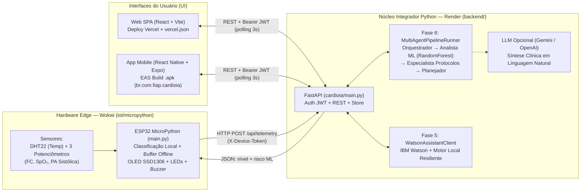

# FIAP - Faculdade de Informática e Administração Paulista

<p align="center">
<a href= "https://www.fiap.com.br/"></a>
</p>

<br>

# CardioIA

## Vídeos:
- **Fase 7 (MVP Final Integrado):** `[COLE_AQUI_O_LINK_DO_YOUTUBE_DA_FASE_7]`
- Fase 6 (Sistema Multiagente): [https://youtu.be/mDPamQwldME](https://youtu.be/mDPamQwldME)
- Fase 5 (Assistente Conversacional): [https://youtu.be/mb6T__vdnBE](https://youtu.be/mb6T__vdnBE)

## 👨‍🎓 Integrantes: 
- <a href="https://www.linkedin.com/in/douglas-souza-felipe-b815281a2/">Douglas de Souza Felipe</a>

## 👩‍🏫 Professores:
### Tutor(a) 
- Caique Nonato
### Coordenador(a)
- André Godoi Chiovato

---

## 🚀 Fase 7 — Plataforma de Inteligência Cardíaca Total (MVP Final)

A Fase 7 integra todos os módulos construídos ao longo do projeto em uma arquitetura unificada em Python, conectando o hardware simulado em **MicroPython (Wokwi)** ao **Backend Integrador (FastAPI no Render)**, aos motores de **Machine Learning + Sistema Multiagente (Fase 6)** e **Assistente Conversacional (Fase 5)**, entregando os insights em tempo real na aplicação **Web (React + Vite na Vercel)** e no aplicativo **Mobile (React Native + Expo EAS Build `.apk`)**.

### 🔗 Links Oficiais de Entrega (Fase 7)

| Entregável | Link / Localização |
| :--- | :--- |
| **🌐 Aplicação Web (Vercel — CI/CD ativo)** | `https://cardioia.vercel.app` *(substitua pela URL final da Vercel após o deploy)* |
| **⚙️ Backend Integrador Python (Render)** | `https://cardioia-backend-ewbv.onrender.com` *(substitua pela URL final do Render)* |
| **📱 Build Mobile `.apk` (Expo EAS Dashboard)** | `[COLE_AQUI_O_LINK_DO_BUILD_NO_EXPO_DASHBOARD]` |
| **🔌 Simulação Hardware MicroPython (Wokwi)** | `[COLE_AQUI_O_LINK_PUBLICO_DO_PROJETO_WOKWI]` |
| **📄 Relatório Técnico (≤ 5 páginas)** | [`docs/relatorio_tecnico_fase7.md`](docs/relatorio_tecnico_fase7.md) |
| **🎬 Roteiro do Vídeo & Guia de Deploy** | [`docs/roteiro_video_fase7.md`](docs/roteiro_video_fase7.md) |

> **Credenciais de demonstração (Web e Mobile):**
> - **Perfil Médico:** usuário `medico` · senha `cardio123` *(dashboard completo, probabilidade ML, protocolos clínicos, trilha multiagente e simulador)*
> - **Perfil Paciente:** usuário `paciente` · senha `cardio123` *(visão simplificada em linguagem acessível + chat integrado)*

### 🏗️ Arquitetura Final (`Sensor → MicroPython → Backend Python → APIs de IA → UI`)



### 📂 Estrutura dos Arquivos Obrigatórios da Fase 7

```text
CardioIA/
├── vercel.json                     # Configuração de build e rewrite SPA na raiz
├── render.yaml                     # Blueprint de deploy automático do Backend Python no Render
├── backend/                        # Núcleo Integrador em Python (FastAPI)
│   ├── cardioia/
│   │   ├── main.py                 # Endpoints (/api/auth/login, /api/telemetry, /api/dashboard, /api/chat...)
│   │   ├── ai_engine.py            # Integração com ML + Multiagente (Fase 6) e LLM opcional
│   │   ├── chat_service.py         # Integração com Chatbot Watson/Local (Fase 5) + contexto de vitais
│   │   ├── vitals_rules.py         # Regras clínicas determinísticas compartilhadas com a borda
│   │   ├── auth.py                 # Autenticação JWT (perfis médico e paciente) + token do dispositivo
│   │   └── store.py                # Buffer thread-safe de leituras e histórico de alertas
│   ├── bootstrap_model.py          # Treina o pipeline ML da Fase 6 automaticamente no build
│   ├── requirements.txt
│   └── tests/test_api.py           # Testes automatizados fim-a-fim da API integradora
├── iot/
│   ├── src/main.cpp                # Firmware original C/C++ (Fase 3 - preservado)
│   └── micropython/                # Transição para MicroPython (Fase 7)
│       ├── main.py                 # Captura DHT22 + 3 potenciômetros, análise edge, OLED, LEDs, buzzer e POST HTTP
│       ├── ssd1306.py              # Driver I²C do display OLED 128x64
│       └── diagram.json            # Circuito completo para simulação no Wokwi
├── frontend/                       # Aplicação Web (React + Vite)
│   ├── vercel.json                 # Suporte a rotas SPA (/login, /dashboard, /chat) na Vercel
│   └── src/
│       ├── pages/Login.jsx         # Login com seleção rápida de perfil (Médico / Paciente)
│       ├── pages/Dashboard.jsx     # Indicadores de risco, gráfico em tempo real, protocolos e trilha de agentes
│       └── pages/Chat.jsx          # Assistente conversacional integrado aos sinais vitais
└── mobile/                         # Aplicação Mobile (React Native + Expo Router)
    ├── app.json                    # Configurado com android.package = "br.com.fiap.cardioia"
    ├── eas.json                    # Perfil "preview" configurado para geração de .apk na nuvem do Expo
    └── app/                        # Telas Mobile: login, (tabs)/dashboard e (tabs)/chat
```

### 🛠️ Instruções de Execução e Instalação

#### 1. Backend Integrador Python (`backend/`)
```bash
# 1. Instalar dependências
pip install -r backend/requirements.txt

# 2. Garantir que o modelo preditivo da Fase 6 esteja treinado
python backend/bootstrap_model.py

# 3. Iniciar o servidor FastAPI em http://localhost:8000 (documentação interativa em /docs)
uvicorn cardioia.main:app --reload --port 8000 --app-dir backend

# 4. Executar a suíte de testes automatizados
pytest backend/tests
```

#### 2. Aplicação Web (`frontend/`)
```bash
cd frontend
npm install
npm run dev      # abre em http://localhost:3000 com proxy para http://localhost:8000
npm run build    # gera o bundle de produção em frontend/dist
```

#### 3. Aplicativo Mobile e Instalação do `.apk` (`mobile/`)
```bash
cd mobile
npm install
npx expo start   # desenvolvimento local (Expo Go)

# Gerar o arquivo .apk na nuvem do Expo (EAS Build):
npx eas-cli login
npx eas-cli build -p android --profile preview
```
**Como instalar o `.apk` no dispositivo Android real:**
1. Acesse o link do build no dashboard do Expo (ou escaneie o QR Code gerado pelo EAS Build com a câmera do celular).
2. Baixe o arquivo `.apk` e autorize a instalação de fontes conhecidas caso solicitado pelo Android.
3. Abra o app **CardioIA**, selecione **Médico** (`medico / cardio123`) ou **Paciente** (`paciente / cardio123`) e valide a atualização dos dados cardíacos em tempo real.

#### 4. Simulação Hardware em MicroPython no Wokwi (`iot/micropython/`)
1. Abra o projeto no Wokwi (ou importe `iot/micropython/diagram.json`, `iot/micropython/main.py` e `iot/micropython/ssd1306.py`).
2. Na constante `BACKEND_URL` de `main.py`, informe a URL pública do backend no Render.
3. Inicie a simulação e altere os potenciômetros de **FC (bpm)**, **SpO₂ (%)**, **PA Sistólica (mmHg)** e a temperatura do **DHT22** para observar a resposta imediata no display OLED, nos LEDs/buzzer e nas interfaces Web/Mobile.

### 📸 Prints Comprobatórios do Deploy Concluído

> *(Substitua ou adicione as capturas de tela abaixo na pasta `assets/` antes da entrega final)*
- **Deploy Web na Vercel (CI/CD ativo):** ``
- **Build do `.apk` no Dashboard do Expo (EAS Build):** ``
- **Simulação MicroPython em execução no Wokwi:** ``
- **Aplicação Web e Mobile exibindo dados cardíacos em tempo real:** ``

---

## Parte 1 – Dados Numéricos (IoT)

Nesta seção, realizamos a análise exploratória e técnica do dataset `cardio_train.csv`, que compõe a base de dados numéricos (IoT) do ecossistema CardioIA. O dataset é composto por registros clínicos de pacientes, totalizando 70.000 linhas e 13 colunas.

### Metadados do Dataset

| Variável | Descrição | Tipo de Dado |
| :--- | :--- | :--- |
| **id** | Identificador único do paciente | Inteiro |
| **age** | Idade do paciente (em dias) | Inteiro |
| **gender** | Gênero (1: Feminino, 2: Masculino) | Categórico |
| **height** | Altura (cm) | Inteiro |
| **weight** | Peso (kg) | Float |
| **ap_hi** | Pressão Arterial Sistólica | Inteiro |
| **ap_lo** | Pressão Arterial Diastólica | Inteiro |
| **cholesterol** | Nível de Colesterol (1: Normal, 2: Acima, 3: Muito Acima) | Categórico |
| **gluc** | Nível de Glicose (1: Normal, 2: Acima, 3: Muito Acima) | Categórico |
| **smoke** | Fumante (0: Não, 1: Sim) | Binário |
| **alco** | Consumo de Álcool (0: Não, 1: Sim) | Binário |
| **active** | Atividade Física (0: Não, 1: Sim) | Binário |
| **cardio** | Presença de Doença Cardiovascular (Alvo) | Binário |

### Destaque Clínico e Justificativa de IA

Para o treinamento do modelo de Machine Learning, destacamos as seguintes variáveis core:

1.  **Pressão Arterial Sistólica (ap_hi):** É o indicador de maior peso para a predição de risco cardiovascular; variações súbitas ou crônicas são cruciais para a detecção de anomalias e predição de hipertensão.
2.  **Colesterol (cholesterol):** Atua como uma variável categórica de risco metabólico. Sua forte correlação com a ocorrência de aterosclerose torna-a indispensável para modelos de classificação.
3.  **Idade (age):** A idade é o fator de base para qualquer escore de risco clínico, permitindo ao algoritmo ponderar a progressão de doenças crônicas não transmissíveis (DANTs).
4.  **Peso (weight):** Fundamental para o cálculo de índices de massa corpórea (IMC) e avaliação de riscos associados à obesidade, servindo como uma variável explicativa de suporte.

**Justificativa Técnica:** Estas variáveis foram selecionadas devido à sua alta **correlação estatística** com o desfecho clínico (`cardio`). Em modelos de aprendizagem supervisionada, a inclusão desses biomarcadores permite uma maior precisão na **predição de risco**, visto que representam os pilares da fisiopatologia cardiovascular. A presença de outliers nos dados de pressão arterial reforça a necessidade de algoritmos de detecção de anomalias durante a fase de pré-processamento.

### Análise Descritiva e Origem dos Dados

Através de um script de análise descritiva, extraímos os seguintes insights populacionais do dataset:
*   **Média de Idade:** 53,33 anos.
*   **Distribuição de Gênero:** Aproximadamente 65% de mulheres (45.530 registros) e 35% de homens (24.470 registros).

> **Nota Metodológica:** Os dados populacionais acima descritos são apresentados exclusivamente de forma visual e didática. Eles refletem apenas a amostra contida neste dataset específico e podem não representar uma tendência epidemiológica global ou regional.

**Fonte dos Dados:** O dataset utilizado nesta análise foi obtido via [Kaggle - Cardiovascular Disease Dataset](https://www.kaggle.com/datasets/sulianova/cardiovascular-disease-dataset).

## Parte 2 - Documentos usados

### Resumo das Obras Selecionadas
Selecionamos cinco obras fundamentais que cruzam a história da medicina, a saúde pública brasileira e o estado da arte em tecnologia. O objetivo é fornecer uma base textual rica e diversificada para o processamento de linguagem natural.

1. **Plano DANT (Gov. BR 2021-2030):** Documento estratégico que mapeia o enfrentamento de doenças crônicas no Brasil. Fornece o contexto epidemiológico e as metas de saúde pública para a próxima década.
2. **Cases of Organic Diseases of the Heart (John Collins Warren):** Obra histórica que apresenta relatos de casos clínicos reais do século XIX. Essencial para análise de descrição de sintomas em linguagem natural.
3. **Diretrizes Brasileiras de Hipertensão Arterial (2020):** O padrão para o diagnóstico e tratamento no Brasil. Contém terminologia técnica precisa, valores de referência e protocolos clínicos modernos.
4. **Impacto da Inteligência Artificial na Cardiologia:** Artigo científico que discute como algoritmos já estão transformando o setor, servindo como base teórica e técnica para o desenvolvimento do ecossistema CardioIA.
5. **William Harvey and the Discovery of the Circulation of the Blood (Huxley):** Texto biográfico e técnico sobre a descoberta da circulação. Oferece uma perspectiva sobre a fisiologia fundamental do sistema cardiovascular.

#### Referências
1. **Plano DANT (Gov. BR 2021-2030):** [https://www.gov.br/saude/pt-br/centrais-de-conteudo/publicacoes/svsa/doencas-cronicas-nao-transmissiveis-dcnt/09-plano-de-dant-2022_2030.pdf/view](https://www.gov.br/saude/pt-br/centrais-de-conteudo/publicacoes/svsa/doencas-cronicas-nao-transmissiveis-dcnt/09-plano-de-dant-2022_2030.pdf/view)
2. **Cases of Organic Diseases of the Heart (John Collins Warren):** [https://www.gutenberg.org/ebooks/26836](https://www.gutenberg.org/ebooks/26836)
3. **Diretrizes Brasileiras de Hipertensão Arterial (2020):** [https://www.scielo.br/j/abc/a/Z6m5gGNQCvrW3WLV7csqbqh/?lang=pt](https://www.scielo.br/j/abc/a/Z6m5gGNQCvrW3WLV7csqbqh/?lang=pt)
4. **Impacto da Inteligência Artificial na Cardiologia:** [https://www.scielo.br/j/abc/a/VNQtkGdM85HdjCXKJ6ZgXkQ/?lang=pt](https://www.scielo.br/j/abc/a/VNQtkGdM85HdjCXKJ6ZgXkQ/?lang=pt)
5. **William Harvey and the Discovery of the Circulation of the Blood (Huxley):** [https://www.gutenberg.org/ebooks/2939](https://www.gutenberg.org/ebooks/2939)

---

### Justificativa para o Uso de NLP

A integração desses textos no CardioIA não é apenas documental; eles servem como insumos para três frentes principais de Inteligência Artificial:

* **Extração de Entidades Nomeadas (NER):** Através dos textos de Warren e das Diretrizes de 2020, o modelo pode aprender a identificar e extrair termos médicos específicos (como "isquemia", "pressão sistólica", "hipertrofia ventricular") em prontuários não estruturados, automatizando a triagem de dados.
* **Análise de Sentimento e Semântica em Saúde:** O Plano DANT permite analisar o "tom" das políticas públicas e a urgência de certas patologias, enquanto os relatos de casos históricos ajudam a entender a evolução da descrição da dor e do desconforto pelo paciente.
* **Sumarização e Classificação Automática:** Com artigos densos como o de "Impacto da IA", podemos treinar modelos para gerar resumos executivos para médicos ou classificar automaticamente novos artigos científicos que entrem na base de dados do hospital, mantendo o ecossistema sempre atualizado.

---

## Parte 3 – Dados Visuais (VC)

Nesta etapa, o ecossistema CardioIA incorpora o processamento de bioimagens de Raio-X de Tórax para diagnósticos de precisão. O dataset visual é composto por exames de Raio-X de Tórax no formato de imagem, organizados e filtrados em categorias clínicas de impacto cardiológico direto (Cardiomegaly e Effusion) e um grupo de controle (No Finding).

### Estratégia de Armazenamento e Governança
Para evitar o armazenamento de gigabytes de dados de imagens no versionamento do Git, o dataset completo é baixado dinamicamente no início da execução utilizando a biblioteca `kagglehub`. O volume massivo de dados utilizado para o treinamento está hospedado em:
*   **Dataset Completo:** [NIH Chest X-rays - Kaggle](https://www.kaggle.com/datasets/nih-chest-xrays/data)

### Justificativa de IA (Visão Computacional)
A utilização de algoritmos de Visão Computacional (VC) é fundamental para a interpretação automatizada de exames de radiografia de tórax. Através de Redes Neurais Convolucionais (CNNs), o sistema realiza a extração automática de características morfológicas das estruturas torácicas, auxiliando na identificação do tamanho do coração e na presença de fluidos anômalos.

**Classificador de Patologias:** Especificamente, o processamento destas imagens permite treinar classificadores para identificar patologias específicas de interesse do CardioIA: **Cardiomegaly** (hipertrofia cardíaca / coração aumentado) e **Effusion** (derrame pleural, comumente correlacionado a quadros de insuficiência cardíaca). Ao sinalizar as anomalias morfológicas nos exames, o CardioIA atua como uma ferramenta de suporte à decisão clínica, otimizando a triagem hospitalar e agilizando o atendimento.

---

### Papel no Projeto CardioIA

Estes dados textuais formam o "cérebro interpretativo" da plataforma. Enquanto os dados numéricos dizem *o que* está acontecendo agora, e as imagens mostram *onde* está o problema, o processamento destes textos permite ao CardioIA entender o contexto clínico, histórico e normativo, garantindo que as decisões da IA estejam alinhadas com as diretrizes médicas vigentes e com a compreensão humana da doença.

---

## Parte 4 – Frases de sintomas + extração de informações

Esta fase implementa um "estetoscópio digital" rodando em Inteligência Artificial para Diagnóstico. Criamos um motor de Processamento de Linguagem Natural (NLP) usando **spaCy** e **Scikit-learn** capaz de analisar um texto de um paciente, extrair as informações cruciais (lematização e filtragem sintática de sujeitos/verbos), e correlacionar com uma ontologia de doenças previamente mapeada por vetores matemáticos.

Os artefatos produzidos encontram-se rigorosamente distribuídos em módulos na pasta `api/`:
* `api/data/`: Diretório contendo os casos de uso das queixas (`relatos.txt`) e a ontologia teórica extraída dos livros médicos (`ontologia.csv`).
* `api/core/`: Regras de negócio essenciais.
* `api/infrastructure/`: Adaptadores responsáveis pela predição e leitura robusta.
* `api/tests/`: Suite de testes.
* `api/main.py`: O Script Pai que inicializa e orquestra a aplicação.

### Como Executar e Testar

Acesse a subpasta `api`, configure o ambiente virtual suportando o modelo neutro brasileiro (`pt_core_news_sm`):

```bash
cd api
python -m venv .venv
# Ativar venv no Windows:
.\.venv\Scripts\activate
# Ativar venv no Linux/Mac:
source .venv/bin/activate

# Instale as dependências da Machine Learning
pip install -r requirements.txt
python -m spacy download pt_core_news_sm

# Rodar Pipeline principal de triagem:
python main.py

# Validar se todo o framework de abstração resiste:
pytest tests/ -v
```
## Parte 5 – Classificador de Risco (ML)

Esta fase representa a inteligência preditiva do CardioIA voltada para a triagem de urgência. Foi desenvolvido um **Classificador de Texto** que categoriza automaticamente os relatos de sintomas em "Baixo Risco" ou "Alto Risco", permitindo uma priorização baseada em dados clínicos.

### Implementação de Machine Learning
O modelo utiliza um pipeline de Processamento de Linguagem Natural e Aprendizagem Supervisionada:
*   **Vetorização:** TF-IDF (*Term Frequency-Inverse Document Frequency*) para transformar sintomas em vetores matemáticos, priorizando palavras-chave clínicas.
*   **Algoritmo:** **SVM (Support Vector Machine)**, selecionado após testes comparativos com diversos algoritmos por apresentar o melhor **Recall para 'Alto Risco'**.
*   **Foco em Segurança:** O modelo foi treinado para minimizar falsos negativos, garantindo que pacientes em estado crítico recebam a classificação de urgência correta.

### Ambiente de Experimentação (`notebooks/`)
Os dados e o laboratório de desenvolvimento estão organizados para garantir a reprodutibilidade:
*   `api/notebooks/classificador_risco.ipynb`: Notebook com a análise exploratória, treino e comparação de métricas.
*   `api/notebooks/dataset_risco.csv`: Dataset sintético curado para o treinamento do classificador.

---

---

## Parte 6 (Fase 5) – Assistente Cardiológico Conversacional (Chatbot com Watson Assistant & Flask)

Esta etapa consolida o **Assistente Conversacional Inteligente do CardioIA**, integrando os conceitos de Processamento de Linguagem Natural, Chatbots & Agentes Virtuais (PCV).

### Funcionalidades do Assistente
* **Modelagem NLU no IBM Watson Assistant:** Definição completa de Intenções (`#saudacao`, `#informar_sintomas`, `#emergencia_cardiaca`, `#informar_dados_vitais`, `#duvidas_prevencao`, `#sobre_cardioia`, `#ajuda`, `#despedida`) e Entidades clínicas (`@sintoma`, `@sinal_vital`, `@fator_risco`).
* **Triagem de Urgência & Ética Médica:** Detecção automática de sintomas de alarme cardiovascular (ex: dor no peito irradiada para o membro superior ou síncope) com acionamento imediato de alerta e recomendação de contato com o **SAMU (192)**.
* **Backend Flask Resiliente:** Servidor Python (`api/app.py`) compatível com a API do IBM Watson Cloud e dotado de motor local de inferência para operação offline imediata.
* **Interface Web Moderna em React (Vite):** Aplicação Single Page em **React** (`frontend/`) com chips de atalho, balões de chat interativos, indicador de digitação, badge dinâmico de nível de risco, ícones Lucide e suporte a reconexão de sessão.

### Entregáveis da Fase
* **Código-fonte do Backend:** Diretório [`api/`](./api/).
* **Interface do Usuário em React:** Diretório [`frontend/`](./frontend/).
* **Arquivo de Exportação do Assistente (JSON):** [`api/chatbot/cardioia_watson_assistant.json`](./CardioIA/api/chatbot/cardioia_watson_assistant.json).
* **Relatório Técnico do Fluxo Conversacional:** [`docs/relatorio_fluxo_conversacional.md`](./CardioIA/docs/relatorio_fluxo_conversacional.md).

### Como Executar o Assistente Conversacional

#### 1. Backend Flask:
```bash
# Acesse o diretório da API
cd api

# Ative o ambiente virtual
# Linux/Mac:
source ../.venv/bin/activate
# Windows:
..\.venv\Scripts\activate

# Instale as dependências
pip install -r requirements.txt

# (Opcional) Configure suas credenciais IBM Watson em .env:
cp .env.example .env

# Inicie o servidor backend
python app.py
```

#### 2. Frontend React:
```bash
# Em outro terminal, acesse a pasta frontend:
cd frontend

# Instale os pacotes npm
npm install

# Inicie o servidor de desenvolvimento
npm run dev

# Acesse no navegador: http://localhost:3000
```

---

## 📁 Estrutura de pastas

Dentre os arquivos e pastas presentes na raiz do projeto, definem-se:

- <b>api</b>: A central de código que abriga o backend Flask (`app.py`), o módulo conversacional Watson (`chatbot/`), a camada de NLP (`core`, `infrastructure`, `tests`).

- <b>frontend</b>: Interface de Usuário completa desenvolvida em **React (Vite)** com componentes conversacionais, chips de atalho e design cardiológico responsivo.

- <b>api/chatbot</b>: Modelagem da Skill em JSON (`cardioia_watson_assistant.json`), cliente de conexão da API Watson e motor local de contingência.

- <b>api/notebooks</b>: Laboratório de Ciência de Dados contendo os experimentos de Machine Learning e datasets sintéticos.

- <b>.github</b>: Nesta pasta ficarão os arquivos de configuração específicos do GitHub que ajudam a gerenciar e automatizar processos no repositório.

- <b>assets</b>: aqui estão os arquivos relacionados a elementos não-estruturados deste repositório, como imagens.

- <b>docs</b>: Artigos, relatórios técnicos (`relatorio_fluxo_conversacional.md`), roteiros e diretrizes de saúde.

- <b>datasets</b>: aqui estão os arquivos relacionados a dados do projeto.

- <b>README.md</b>: arquivo que serve como guia e explicação geral sobre o projeto.


## 🗃 Histórico de lançamentos

* 0.4.0 - 15/09/2026
    * Fase 5: Assistente Cardiológico Conversacional
    * Modelagem de Intents, Entities e Dialog Tree no IBM Watson Assistant
    * Backend Flask com API REST (`/api/chat`, `/api/health`, `/api/triage`)
    * Interface Web Responsiva com triagem dinâmica de risco e atalhos rápidos
    * Relatório técnico e roteiro de vídeo de demonstração
* 0.3.0 - 12/05/2026
    * ESP32 com sensores conectado ao broker MQTT
    * Dashboard com Node-RED
* 0.2.0 - 05/04/2026
    * Parte 1
        * Frases de sintomas + extração de informações
    * Parte 2
        * Implementação do Classificador de Risco
    * Vídeo demonstrativo: https://youtu.be/Mr4dphna-wU
* 0.1.0 - 10/03/2026
    * Estruturação do projeto
    * Obtenção dos dados


## 📋 Licença

<p xmlns:cc="http://creativecommons.org/ns#" xmlns:dct="http://purl.org/dc/terms/"><a property="dct:title" rel="cc:attributionURL" href="https://github.com/agodoi/template">MODELO GIT FIAP</a> por <a rel="cc:attributionURL dct:creator" property="cc:attributionName" href="https://fiap.com.br">Fiap</a> está licenciado sobre <a href="http://creativecommons.org/licenses/by/4.0/?ref=chooser-v1" target="_blank" rel="license noopener noreferrer" style="display:inline-block;">Attribution 4.0 International</a>.</p>


