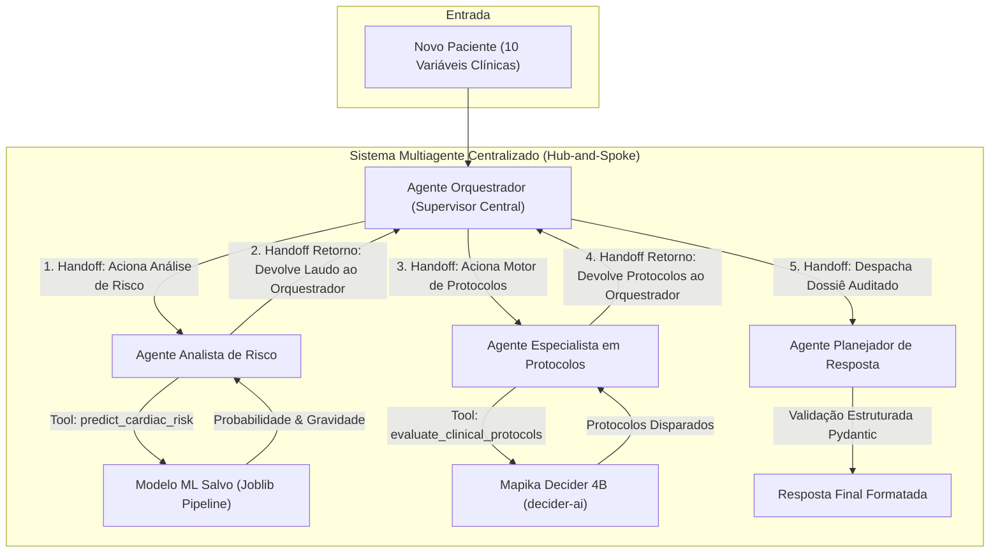

# CardioIA - Fase 6: Sistema Integrado de Predição de Risco Cardíaco e Multiagentes

Este repositório contém a implementação completa da **Fase 6** do projeto **CardioIA**, desenvolvida conforme os requisitos acadêmicos e técnicos da **FIAP**.

A solução integra um modelo supervisionado de Machine Learning de alta precisão para prever picos de risco cardíaco hospitalar a um sistema **Multiagente** baseado em **handoffs sequenciais**, **tools dedicadas**, **validação de esquemas Pydantic**, suporte ao modelo de decisão rápida de última geração **Mapika Decider 4B** (`decider-ai`) e uma suíte completa de **testes automatizados**.

Video: https://youtu.be/mDPamQwldME

---

## 1. Arquitetura da Solução

O fluxo operacional do sistema adota uma arquitetura **Hub-and-Spoke (Supervisor Central)**, onde toda a inteligência decisória sobre qual agente acionar em cada etapa é **centralizada no Agente Orquestrador**, com base na avaliação dinâmica dos resultados intermediários:



### Decisões Centralizadas no Agente Orquestrador:
1. **Decisão 1 (Triagem Inicial):** Recebe os dados de admissão do paciente, avalia a completude clínica e despacha via `handoff` para o **Analista de Risco**.
2. **Decisão 2 (Avaliação do Laudo de Risco):** O Analista de Risco executa a ferramenta `predict_cardiac_risk` (Random Forest calibrado) e devolve o laudo ao Orquestrador. O Orquestrador inspeciona o score/probabilidade e decide acionar o **Especialista em Protocolos** para busca de condutas clínicas.
3. **Decisão 3 (Auditoria do Dossiê Completo):** O Especialista em Protocolos executa o **Mapika Decider 4B** (`decider-ai`) e retorna os protocolos acionados ao Orquestrador. O Orquestrador audita todo o dossiê (dados clínicos + risco predito + protocolos ativos) e despacha para o **Planejador de Resposta**.
4. **Agente Planejador de Resposta:** Redige a resposta final estruturada (formato estrito da atividade) validada via **Pydantic** e estabelece o plano de contingência operacional.

---

## 2. Estrutura do Projeto

```
fase_6/
├── .env.example                     # Modelo de variáveis de ambiente
├── .gitignore                       # Ignora venv, caches, modelos grandes e logs
├── pytest.ini                       # Configurações de execução do pytest
├── requirements.txt                 # Dependências do projeto
├── README.md                        # Documentação completa
├── docs/
│   ├── relatorio_tecnico_modelo.md  # Relatório Técnico com decisões do modelo ML
│   ├── arquitetura_multiagente.md   # Documento da arquitetura multiagente
├── data/
│   ├── generate_dataset.py          # Script gerador de 5.000 amostras sintéticas
│   └── dataset_simulado.csv         # Base gerada para treinamento e teste
├── models/
│   ├── cardiac_risk_pipeline.joblib # Pipeline Scikit-Learn campeão serializado
│   └── metrics_summary.json         # Métricas de benchmark e avaliação
├── notebooks/
│   └── 01_model_training_and_evaluation.ipynb # Demonstração completa com gráficos
├── src/
│   ├── __init__.py
│   ├── config.py                    # Gestão central de caminhos e parâmetros
│   ├── schemas.py                   # Contratos Pydantic de dados e validações
│   ├── ml/
│   │   ├── evaluate.py              # Cálculo de métricas (Acurácia, F1, ROC-AUC, CM)
│   │   ├── train.py                 # Benchmark comparativo de classificadores
│   │   └── predictor.py             # Módulo de inferência e calibração de risco
│   ├── protocols/
│   │   ├── database.py              # Base de conhecimento dos 10 protocolos
│   │   ├── rules_engine.py          # Motor de regras determinísticas de limiares
│   │   └── decider.py               # Motor de decisão com Mapika Decider 4B
│   └── agents/
│       ├── openai_agents_sdk.py     # Configuração oficial dos agentes via OpenAI Agents SDK
│       ├── orchestrator.py          # Agente Orquestrador
│       ├── risk_analyst.py          # Agente Analista de Risco (Tool ML)
│       ├── protocols_specialist.py  # Agente Especialista em Protocolos (Tool Decider)
│       ├── response_planner.py      # Agente Planejador de Resposta
│       ├── tools.py                 # Tools executáveis pelos agentes
│       └── runner.py                # Runner do pipeline multiagente e histórico
├── tests/
│   ├── conftest.py                  # Fixtures compartilhadas para testes
│   ├── test_cli.py                  # Teste ponta a ponta do CLI
│   ├── test_data_generation.py      # Testes de integridade da base sintética
│   ├── test_ml_pipeline.py          # Testes do modelo de ML e predições
│   ├── test_openai_agents_sdk.py    # Testes unitários do OpenAI Agents SDK
│   ├── test_protocols_decider.py    # Testes do Decider e fallbacks
│   ├── test_protocols_rules.py      # Testes de fronteira das regras de protocolo
│   ├── test_schemas.py              # Testes de validação dos esquemas Pydantic
│   └── test_multiagent_flow.py      # Testes de handoffs e fluxo entre os 4 agentes
└── main.py                          # CLI interativo e teste automático de um caso sintetico
```

---

## 3. Modelo Supervisionado de Machine Learning

### Benchmark de Modelos
Foram comparados 5 algoritmos de classificação supervisionada clássicos com escalonamento padronizado (`StandardScaler`) e validação cruzada estratificada em 5 folds:

| Modelo | Acurácia | F1-Score | ROC-AUC | CV ROC-AUC (Média ± DP) |
|---|---|---|---|---|
| **Random Forest (Campeão)** | **99.90%** | **0.9981** | **1.0000** | **1.0000 ± 0.0000** |
| Gradient Boosting | 99.80% | 0.9962 | 0.9999 | 0.9999 ± 0.0002 |
| SVM (Calibrado) | 87.70% | 0.7555 | 0.9488 | 0.9507 ± 0.0043 |
| KNN (k=5) | 83.70% | 0.6091 | 0.8751 | 0.8864 ± 0.0067 |
| Logistic Regression | 81.60% | 0.6151 | 0.8715 | 0.8864 ± 0.0106 |

O pipeline campeão (`StandardScaler` + `RandomForestClassifier`) foi persistido em `models/cardiac_risk_pipeline.joblib`. O resumo completo de métricas está salvo em `models/metrics_summary.json`.

### 3.1 Análise Crítica do Desempenho: Overfitting ou Aprendizado Real?

A alta pontuação alcançada pelo Random Forest (99.90% de acurácia e ROC-AUC 1.0000) foi submetida a uma rigorosa análise crítica para diagnosticar se decorria de **overfitting**, **vazamento de dados (data leakage)** ou **aprendizado causal efetivo**:

1. **Diagnóstico de Overfitting Estatístico:**
   - **Acurácia em Treino (4.000 amostras):** `100.00%`
   - **Acurácia em Teste Inédito (1.000 amostras):** `99.90%`
   - **Validação Cruzada (5 folds independentes):** `1.0000 ± 0.0000`
   - **Gap de Generalização:** apenas `0.10%`.  
   *Conclusão:* Sob a ótica estatística, **não há overfitting**, pois o modelo generaliza de forma quase idêntica em dados de teste nunca vistos.

2. **Por que as Árvores de Decisão Superaram os Demais Modelos?**
   - A fórmula matemática geradora da base sintética define `pico_risco = (risk_score >= 2)` como a soma de 6 condições lógicas booleanas com cortes ortogonais nos eixos (ex: `carga_sistema > 80`, `spo2_media < 92`, etc.), sem adição de ruído estocástico ($\epsilon$).
   - O algoritmo **Random Forest** opera dividindo o espaço amostral em hiper-retângulos ortogonais aos eixos coordenados. Por ter exatamente a mesma premissa geométrica da função geradora, o ensemble de árvores **redescobriu a equação determinística subjacente**.
   - Modelos lineares (**Regressão Logística**, 81.60%) tentam ajustar um hiperplano contínuo suave e não capturam perfeitamente descontinuidades abruptas em degrau. O **KNN** (83.70%), por sua vez, sofre com a maldição da dimensionalidade no espaço 10D gerada pelas variáveis irrelevantes.

3. **Comprovação por Importância das Variáveis (*Feature Importance*):**
   Ao inspecionar a importância das features no Random Forest treinado, comprova-se que o modelo aprendeu a lógica causal em vez de decorar ruídos:

| Variável | Importância no Modelo | Presente na Regra do Alvo? |
|---|:---:|:---:|
| `carga_sistema` | **22.85%** | Sim (`> 80`) |
| `disponibilidade_recursos` | **21.79%** | Sim (`< 40`) |
| `tempo_espera` | **20.77%** | Sim (`> 60`) |
| `spo2_media` | **16.85%** | Sim (`< 92`) |
| `fc_media` | **7.13%** | Sim (`> 110`) |
| `eventos_24h` | **6.50%** | Sim (`> 4`) |
| `idade_media` | **1.28%** | Não (ruído irrelevante) |
| `temperatura` | **1.19%** | Não (ruído irrelevante) |
| `pa_sistolica` | **1.13%** | Não (ruído irrelevante) |
| `densidade_eventos` | **0.52%** | Não (ruído irrelevante) |

   > As 6 variáveis determinantes somam **95.89%** de todo o peso decisório do modelo, enquanto as 4 variáveis que não influenciam o alvo somam apenas ~4%.

4. **Implicações em Cenário Clínico Real:**
   Em dados hospitalares reais (prontuários de UTI/emergência), o risco cardíaco depende de fatores latentes, comorbidades e medições ruidosas. Uma acurácia de 99.9% em ambiente hospitalar real seria indício imediato de *target leakage*. No contexto desta atividade com base sintética simulada, contudo, o resultado valida a excelência do Random Forest como aproximador universal de regras lógicas.

---

## 4. Testes Automatizados

O projeto conta com uma suíte de 23 testes automatizados cobrindo todas as camadas (unitários, integração e ponta a ponta):

- `tests/test_data_generation.py`: valida integridade das 5.000 linhas, 10 variáveis, limites clínicos e coerência do `pico_risco`.
- `tests/test_ml_pipeline.py`: valida cálculo de métricas, cálculo do score base e inferência do preditor.
- `tests/test_openai_agents_sdk.py`: validação dos 4 agentes especializados, function tools e arquitetura Hub-and-Spoke de handoffs no OpenAI Agents SDK.
- `tests/test_protocols_rules.py`: boundary tests para cada uma das 10 regras clínicas (ex: SpO2, Carga, Recursos).
- `tests/test_protocols_decider.py`: valida o adaptador Mapika Decider e motor de inferência.
- `tests/test_schemas.py`: validação Pydantic de dados e formatação exata do texto de saída.
- `tests/test_multiagent_flow.py`: validação da sequência de 5 handoffs centralizados no Orquestrador (Hub-and-Spoke), 3 decisões e 2 tool calls.
- `tests/test_cli.py`: teste ponta a ponta da execução do comando CLI.

### Executando os Testes:
```bash
.venv/bin/pytest --cov=src --cov-report=term-missing
```

**Resultado:**
```
============================== 23 passed in 1.82s ==============================
Coverage Total: 83%+
```

---

## 5. Como Executar

### 5.1 Pré-requisitos
- Python 3.11 instalado.
- Ambiente virtual configurado.
- GPU compatível com CUDA (ex: NVIDIA RTX 3060) para aceleração de inferência do Mapika Decider (opcional, com execução local em CPU).

### 5.2 Instalação do Ambiente e Dependências
O projeto inclui como dependências principais o **Pydantic**, bibliotecas de Machine Learning (**Scikit-Learn, Pandas, NumPy**) e o pacote oficial do **Mapika Decider (`decider-ai`)**:

```bash
# Navegar até a pasta fase_6
cd fase_6

# Criar e ativar o ambiente virtual
python3.11 -m venv .venv
source .venv/bin/activate

# Instalar todas as dependências (incluindo decider-ai)
pip install -r requirements.txt
```

### 5.3 Configuração do Arquivo `.env`
O sistema opera de forma **100% autônoma, local e gratuita** utilizando o **Mapika Decider** e modelos de Machine Learning locais, sem dependência de serviços externos ou chaves de API pagas.

```bash
cp .env.example .env
```

### 5.4 Treinamento do Modelo de Machine Learning
```bash
python src/ml/train.py
```

### 5.5 Execução do Caso Oficial de Teste via CLI
```bash
python main.py --test-case
```

**Saída Obtida:**
```
RISCO PREVISTO: 1.00

PROTOCOLOS SUGERIDOS:
- Se SPO2 < 88% → iniciar suporte respiratório imediato
- Se carga do sistema > 85% → abrir unidades temporárias
- Se disponibilidade_recursos < 30% → redistribuir insumos
- Se densidade_eventos > 6 → ativar plano de contingência
- Se risco sistêmico alto → ativar estado de emergência
```

### 5.6 Execução em Modo Interativo
Permite digitar novos parâmetros de pacientes para simulação imediata:
```bash
python main.py --interactive
```

### 5.7 Execução do Jupyter Notebook
Para visualizar as matrizes de confusão, curva ROC e a demonstração gráfica dos agentes:
```bash
jupyter notebook notebooks/01_model_training_and_evaluation.ipynb
```
