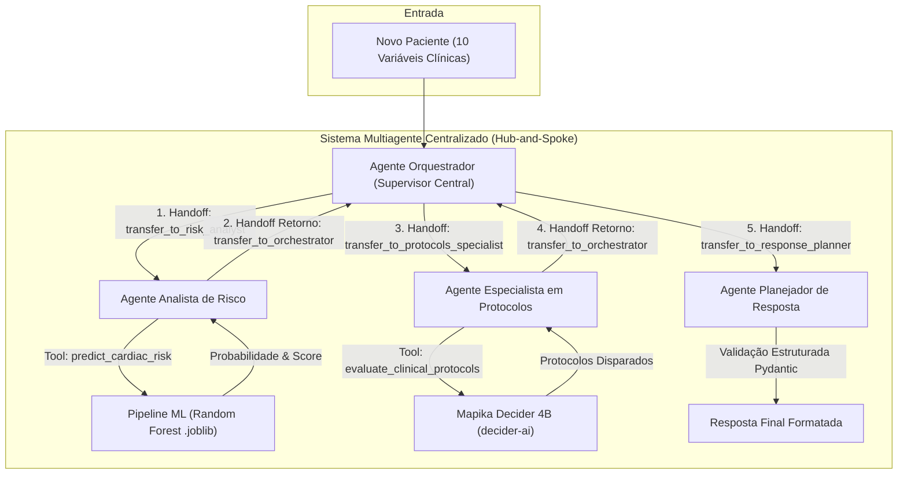

# Especificação da Arquitetura Multiagente CardioIA
**CardioIA - Fase 6 | FIAP Especialização em Inteligência Artificial**  
*Autores: Equipe CardioIA* | *Data: Outubro de 2026* | *Versão: 1.0 (Final)*

---

## 1. Visão Geral e Diagrama da Arquitetura

O sistema multiagente do **CardioIA Fase 6** foi desenvolvido em conformidade com o padrão **OpenAI Agents SDK** (`Agent`, `Runner`, `function_tool`, `handoff`). 

Diferente de esteiras lineares cegas, adota-se o padrão arquitetural **Hub-and-Spoke (Supervisor Central)**. Nele, o **Agente Orquestrador** atua como nó central e supervisor clínico, tomando **três decisões explícitas de roteamento** baseadas nas respostas intermediárias devolvidas pelos agentes operários antes de cada novo despacho.



### 1.1 Vantagens da Centralização no Orquestrador
* **Auditoria Contínua:** Nenhuma informação clínica transita entre agentes periféricos sem ser previamente validada e registrada pelo supervisor.
* **Governança Hospitalar:** O Orquestrador pode abortar o fluxo, acionar contingências ou rejeitar entradas inconsistentes antes de mobilizar recursos adicionais.
* **Resiliência e Desacoplamento:** Cada agente operário especializa-se em uma única responsabilidade funcional, devolvendo seu artefato diretamente à central.

---

## 2. O Papel de Cada Agente Especializado

O sistema distribui as responsabilidades cognitivas e operacionais entre quatro agentes autônomos:

| Agente | Perfil de Atuação | Responsabilidade Principal | Ferramentas Associadas |
| :--- | :--- | :--- | :--- |
| **Agente Orquestrador** | Supervisor Clínico Central | Recepção da triagem, validação de integridade, despacho de handoffs e deliberação das decisões centrais 1, 2 e 3. | Handoffs de controle para os 3 agentes |
| **Agente Analista de Risco** | Especialista em Ciência de Dados | Avaliação preditiva estatística, extração de probabilidades calibradas e classificação de gravidade. | `predict_cardiac_risk` (Joblib ML Pipeline) |
| **Agente Especialista em Protocolos** | Especialista em Diretrizes Médicas | Avaliação das 10 regras clínicas hospitalares e cruzamento com a base de protocolos simulados. | `evaluate_clinical_protocols` (Mapika Decider 4B) |
| **Agente Planejador de Resposta** | Gestor Operacional de UTI | Síntese executiva do dossiê, redação do plano de contingência e garantia de conformidade Pydantic. | Contrato de Saída Estruturada (`FinalTriageResponse`) |

---

## 3. O Uso de Handoffs e Function Tools

### 3.1 Ciclo de 5 Handoffs Bidirecionais
O tráfego de contexto é realizado via handoffs nativos circulares:
1. **Handoff 1 (`Orquestrador` $\rightarrow$ `Analista de Risco`):** Transfere o dicionário higienizado de atributos fisiológicos e operacionais para inferência.
2. **Handoff 2 de Retorno (`Analista de Risco` $\rightarrow$ `Orquestrador`):** Devolve o laudo preditivo contendo probabilidade de risco contínua e rótulo categórico.
3. **Handoff 3 (`Orquestrador` $\rightarrow$ `Especialista em Protocolos`):** Despacha os parâmetros do paciente juntamente com o risco predito para cruzamento com os protocolos.
4. **Handoff 4 de Retorno (`Especialista em Protocolos` $\rightarrow$ `Orquestrador`):** Devolve a listagem formal dos protocolos ativados e o motor decisório empregado.
5. **Handoff 5 (`Orquestrador` $\rightarrow$ `Planejador de Resposta`):** Transfere o dossiê completo e auditado para consolidação da recomendação final.

### 3.2 Ferramentas Especializadas (Function Tools)
* **`predict_cardiac_risk(patient_data: dict)`:**  
  Carrega o pipeline serializado (`StandardScaler` + `RandomForestClassifier`), executa `predict_proba` e devolve a probabilidade contínua calibrada, o score empírico de regras e a classificação textual de gravidade.
* **`evaluate_clinical_protocols(patient_data: dict, probabilidade_risco: float)`:**  
  Executa o modelo de decisão rápida **Mapika Decider 4B** (`decider-ai`) contra a base de 10 diretrizes hospitalares, contando com fallback determinístico local caso a GPU esteja indisponível.

### 3.3 Validação de Esquemas com Pydantic
A integridade dos dados trafegados é blindada pelos modelos `PatientData`, `RiskPrediction`, `ProtocolRecommendation` e `FinalTriageResponse`, assegurando tipagem estrita, coerência dos intervalos fisiológicos e conformidade exata com o padrão exigido no enunciado da atividade.

---

## 4. Exemplo Real de Execução Ponta a Ponta

### 4.1 Dados de Entrada do Paciente
```json
{
  "idade_media": 62,
  "carga_sistema": 92,
  "tempo_espera": 75,
  "fc_media": 118,
  "spo2_media": 89,
  "pa_sistolica": 100,
  "temperatura": 37.5,
  "densidade_eventos": 7,
  "eventos_24h": 5,
  "disponibilidade recursos": 25
}
```

### 4.2 Histórico de Mensagens e Traço Operacional no Terminal

O histórico de execução gerado pelo `MultiAgentPipelineRunner` evidencia o padrão Hub-and-Spoke com as decisões intermediárias tomadas pelo Orquestrador:

| Tipo | Origem | Destino | Detalhes da Ação / Conteúdo |
| :--- | :--- | :--- | :--- |
| **INPUT** | Usuário / Sistema Hosp. | Agente Orquestrador | Novo paciente recebido (SpO2=89%, FC=118 bpm, Carga=92%). |
| **DECISION** | Agente Orquestrador | Agente Orquestrador | **Decisão 1:** Avalia admissão e decide acionar o Analista de Risco. |
| **HANDOFF** | Agente Orquestrador | Agente Analista de Risco | Despacho dos parâmetros para predição supervisionada. |
| **TOOL_CALL** | Agente Analista de Risco | `predict_cardiac_risk` | Execução do modelo Random Forest (`cardiac_risk_pipeline.joblib`). |
| **TOOL_RESULT**| `predict_cardiac_risk` | Agente Analista de Risco | Probabilidade calculada: **1.00** (Crítico / Pico de Risco). |
| **HANDOFF** | Agente Analista de Risco | Agente Orquestrador | Laudo concluído. Devolve o controle ao Orquestrador. |
| **DECISION** | Agente Orquestrador | Agente Orquestrador | **Decisão 2:** Avalia risco crítico e decide acionar Especialista em Protocolos. |
| **HANDOFF** | Agente Orquestrador | Agente Especialista | Despacho para cruzamento com protocolos hospitalares. |
| **TOOL_CALL** | Agente Especialista | `evaluate_protocols` | Avaliação da base com **Mapika Decider 4B** (`decider-ai`). |
| **TOOL_RESULT**| `evaluate_protocols` | Agente Especialista | 5 protocolos identificados como acionados. |
| **HANDOFF** | Agente Especialista | Agente Orquestrador | Protocolos apurados. Devolve o controle ao Orquestrador. |
| **DECISION** | Agente Orquestrador | Agente Orquestrador | **Decisão 3:** Audita dossiê completo e aciona Planejador de Resposta. |
| **HANDOFF** | Agente Orquestrador | Agente Planejador | Despacho do dossiê auditado para síntese e contingência. |
| **FINAL_OUTPUT**| Agente Planejador | Equipe Médica / Usuário | Parecer final estruturado emitido com plano de contingência. |

### 4.3 Saída Consolidada do Sistema

```text
RISCO PREVISTO: 1.00

PROTOCOLOS SUGERIDOS:
- Se SPO2 < 88% → iniciar suporte respiratório imediato
- Se carga do sistema > 85% → abrir unidades temporárias
- Se disponibilidade_recursos < 30% → redistribuir insumos
- Se densidade_eventos > 6 → ativar plano de contingência
- Se risco sistêmico alto → ativar estado de emergência
```

**Plano de Contingência Operacional Gerado:**
> *"Paciente em estado crítico / pico de risco iminente. Priorizar internação imediata, isolamento de leito com monitoramento multiparamétrico e acionamento imediato da equipe de resposta rápida médica."*
